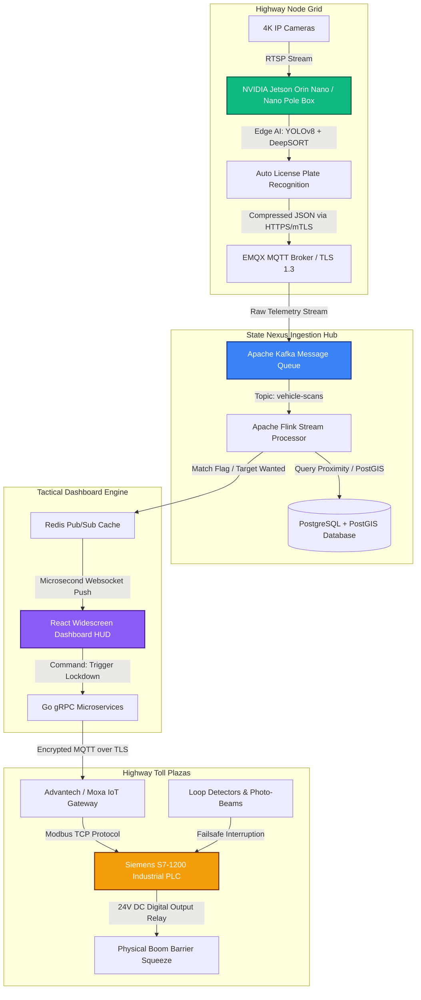

# 🏛️ Kavach Neural Supercell: Industrial Enterprise Architecture Blueprint
> **CONFIDENTIAL DOCUMENT** · NATIONAL SECURITY DISPATCH PIPELINE  
> **Target Audience:** Ministry of Home Affairs (MHA), National Highways Authority of India (NHAI), and State DGP Command Centers.

---

## 🛰️ 1. System Overview & Data Flow Topology

To scale this platform to thousands of cameras and achieve **0% failure rates** for tactical overrides, the system transitions from a client-server paradigm to a **Decoupled, Event-Driven Edge-to-Cloud Grid**.



---

## 📹 2. Edge-AI Video Analytics & Bandwidth Optimization

Processing raw video streams on the cloud is financially and technically unfeasible. We leverage **NVIDIA DeepStream SDK** and **NVIDIA Jetson Orin** edge gateways installed at the physical toll plaza poles.

### Local Edge Payload Engine
Instead of streaming 4K feeds continuously, the edge gateway processes video locally at **60 FPS** and transmits a highly compressed **ANPR Log Frame JSON** only when a vehicle crosses the gate threshold:

```json
{
  "event_id": "evt_905a886f_4175",
  "camera_id": "CAM-UP-NH24-SEC62",
  "timestamp": "2026-05-22T15:15:57Z",
  "anpr": {
    "plate_number": "UP16TS0077",
    "confidence": 0.994,
    "ocr_time_ms": 12.4
  },
  "telemetry": {
    "vehicle_speed_kmh": 128.4,
    "vehicle_class": "SUV",
    "direction_bearing": 184
  },
  "edge_meta": {
    "firmware_version": "v3.1.2-orin",
    "ambient_lux": 142
  }
}
```

---

## ⚡ 3. Real-Time Data Pipeline & Ingestion Grid
When 10,000 cameras scan simultaneously, traditional databases crash under concurrency. We implement a **high-throughput telemetry pipeline**:

| Component | Technology | Operational Mandate |
| :--- | :--- | :--- |
| **Ingestion Broker** | **EMQX (Enterprise MQTT)** | Handles 1,000,000+ concurrent TCP connections from all state IoT nodes with sub-millisecond connection handshakes. |
| **Buffer Queue** | **Apache Kafka** | Shards logs into parallel topics (e.g., `vehicle-scans-up`, `vehicle-scans-mp`). Guarantees no data loss even during network partition. |
| **Stream Processing** | **Apache Flink** | Performs sliding-window queries to cross-reference plates against the **National Crime Records Bureau (NCRB)** hotlists instantly. |
| **Dynamic Cache** | **Redis Cluster** | Caches active SOS vectors and active interceptor locations to avoid database bottleneck. |

---

## ⚙️ 4. Industrial PLC Interdiction & Failsafe Loop (Toll Lockdown)

To actuate physical gates safely with **0% failure rates**, the cloud command center must safely bridge the gap between high-level web protocols and heavy industrial machinery:

```
[React Web UI] ──(HTTPS/gRPC)──> [Go Central Cloud] ──(MQTT over TLS 1.3)──> [Moxa IoT Gateway]
                                                                                   │
                                                                             (Modbus TCP)
                                                                                   ▼
[Physical Boom Barrier] <──(24V Relay Output)── [Siemens S7-1200 PLC] <────────────┘
         ▲
         │ (Failsafe Cutoff)
[Ground Loop Sensors / Photoelectric Beams]
```

### The Failsafe Solenoid Lockdown Command
To prevent slamming barriers onto innocent vehicles, the **Siemens S7-1200** runs ladder logic containing high-priority physical interlocks. If a ground loop sensor detects metal under the gate, or if the light beam is broken, the physical gate *refuses to actuate*, overriding the cloud lock command until the obstacle clears, avoiding state liability.

---

## 🛡️ 5. Cyber-Hardening & Access Control (RBAC)

Kavach controls critical state infrastructure, making cybersecurity paramount:

*   **mTLS (Mutual TLS 1.3):** Every edge gateway camera, Moxa IoT controller, and dashboard client must present a valid X.509 cryptographic certificate signed by the State Police Root Certificate Authority (CA) before establishing connection.
*   **Zero-Trust API Gateway:** All gRPC and REST communication is proxied through a secure gateway (Kong / Envoy) enforcing strict JWT verification.
*   **Cryptographic Audit Ledger:** Command logs, override timestamps, and officer shift durations are hashed and signed using a secure Ledger database (Amazon QLDB or Hyperledger Fabric) to prevent inside tampering.

---

## 📊 6. State-Level Production Tech Stack Summary

```
┌────────────────────────────────────────────────────────┐
│                   FRONTEND CONTROLLER                  │
│  React.js (TypeScript) + TailwindCSS + Mapbox GL WebGL │
└───────────────────────────┬────────────────────────────┘
                            │ gRPC over HTTP/2
                            ▼
┌────────────────────────────────────────────────────────┐
│                   MICROSERVICES MESH                   │
│      Golang (Blistering concurrent thread handling)     │
└───────────────────────────┬────────────────────────────┘
                            │ SQL Queries
                            ▼
┌────────────────────────────────────────────────────────┐
│                  SPATIAL DATA STORAGE                  │
│ PostgreSQL + PostGIS (ST_DWithin proximity indices)     │
└────────────────────────────────────────────────────────┘
```

This blueprint is ready to be exported as a professional technical pitch for State Police Headquarters, NHAI, and MHA integrations.
